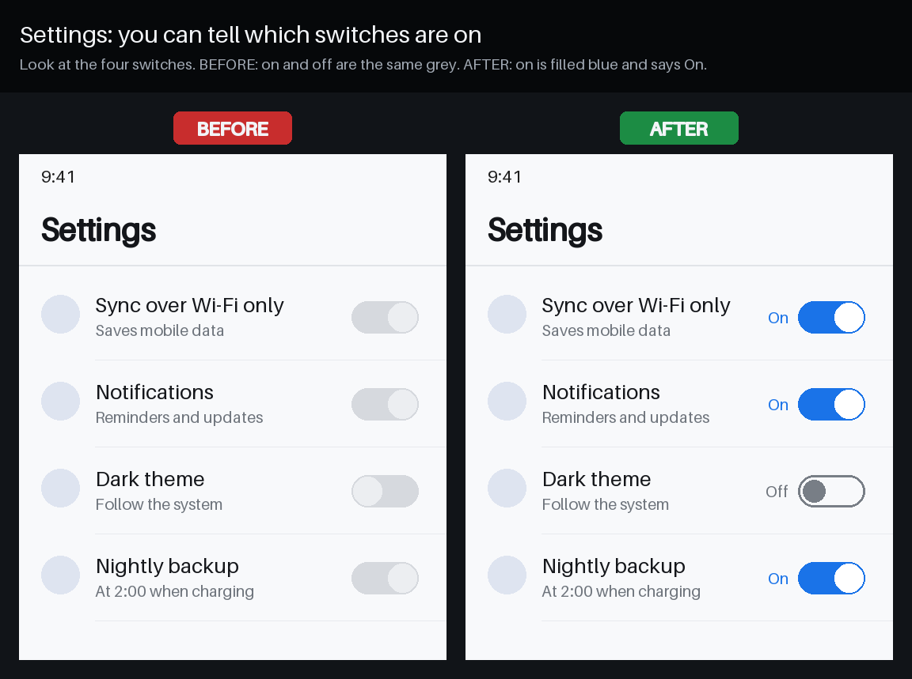
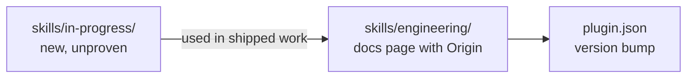

# Ghost Robotics Lab skills

Agent skills from our own shipped work. Each one helped ship a real app, and works in your project too.



## Install

Pick one route, not both. Each gives you the same skills, and two give you every skill twice.

**Claude Code**, from a shell:

```bash
claude plugin marketplace add GhostRoboticsLab/skills
claude plugin install ghostlabs-skills@ghostlabs
```

Or inside a session: `/plugin marketplace add GhostRoboticsLab/skills`, then `/plugin install ghostlabs-skills@ghostlabs`.

Skills load under the plugin's name, such as `/ghostlabs-skills:hand-test`. A release reaches you when its version changes. Auto-update is off by default for a marketplace you add yourself: turn it on for `ghostlabs` in `/plugin`, or run `claude plugin update ghostlabs-skills@ghostlabs`.

**Any other agent, or files you can edit**, through [skills.sh](https://skills.sh):

```bash
npx skills@latest add GhostRoboticsLab/skills
```

Update with `npx skills@latest update`. This route may also offer the beta skills.

As of 0.1.0, the manifests pass `claude plugin validate . --strict` and the plugin installs from a local clone with the shell commands above. The `/plugin` and skills.sh routes are not yet run by us: open an issue if one fails.

## Skills

**Model-invoked**: the agent reaches for these when the task fits, and you can call them by name.

- **[hand-test](./skills/engineering/hand-test/SKILL.md)** ([docs](./docs/engineering/hand-test.md)): Before a change people see, hear or feel ships, show BEFORE and AFTER side by side in one video and one board, and get a person's OK.

**User-invoked**: only you can start these. None yet.

Beta skills are in [skills/in-progress](./skills/in-progress/README.md): public, not in the plugin.

## How a skill gets in



A skill is promoted when it was used in shipped work, holds nothing specific to one project, and does one job that composes with other skills. [CONTRIBUTING.md](./CONTRIBUTING.md) has the bar and how to file issues. Agents working in this repo start at [AGENTS.md](./AGENTS.md).

## Credits

- Scaffolded after [Matt Pocock's skills](https://github.com/mattpocock/skills) (MIT): the bucket folders, the promoted set kept in `plugin.json`, the model-invoked and user-invoked split, `agents/openai.yaml`, the issue templates, and the local link script.
- Skills follow the [Agent Skills](https://agentskills.io) format.

## License

[MIT](./LICENSE), Ghost Robotics Lab.
