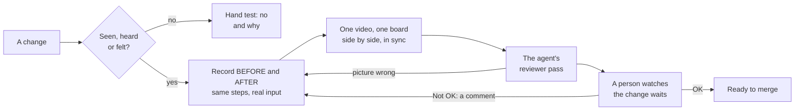
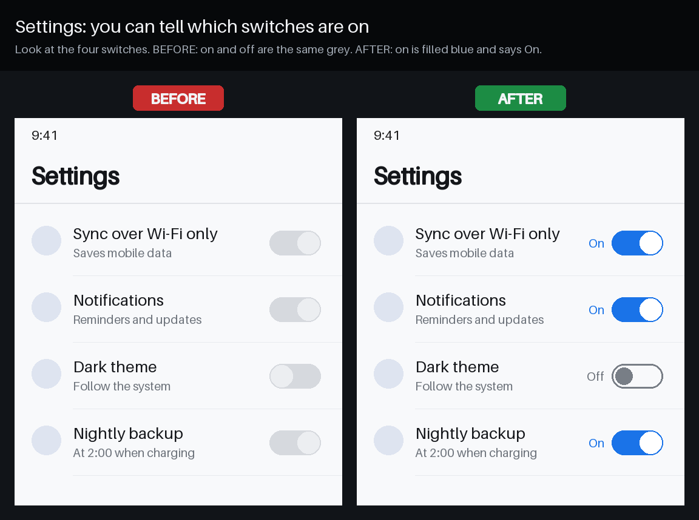

# hand-test

Before a change people see, hear or feel ships, show BEFORE and AFTER side by side in one video and one board, and get a person's OK.

## What it does

`hand-test` makes the evidence a person needs to approve a change they can see, hear or feel: one video and one board, BEFORE beside AFTER, the same place and the same action, so only the one change differs. The two sides play at the same time, lined up on **the moment** the change shows, after a short intro card that says in plain words what changes and how to watch.

The agent never signs off its own hand test. Tests prove what the code does; a hand test proves a person gets what was meant. So the change stays unmerged until a person who can judge it in a minute, cold, says OK.

## When to reach for it

Type `/ghostlabs-skills:hand-test` (installed as the plugin) or `/hand-test` (installed through skills.sh). The agent also reaches for it on its own when a task fits.

| Situation | What happens |
|---|---|
| A PR changes UI, behaviour, timing, sound, copy or design | A full hand test: video, board, README, package, a person's OK |
| A release or milestone | Each change's hand test, rolled up into one report and one page, pending first |
| "Show me what changed" about anything with a before and an after | The same video and board, outside any PR |
| A build, test, docs or refactoring change with the same output | `Hand test: no` in the PR body, with the reason, and nothing more |

## Prerequisites

- ffmpeg and ffprobe on PATH, and [uv](https://docs.astral.sh/uv/) (or Python 3.9+ with Pillow).
- A project file, `docs/agents/hand-test.md`, which the skill writes on its first run in a project after reading the repo and asking you only what it cannot find: who approves, where evidence lives, what OK and Not OK do in your tracker, and which devices it may touch.
- A way to drive your app with real input: Playwright for the web, adb or scrcpy for Android, a UI test framework for iOS, VHS for a terminal. The skill's capture recipes cover each.

## One video, side by side

A series of screenshots makes the viewer hunt for the difference. Two recordings played one after the other make them remember the first while watching the second. BEFORE and AFTER playing at once, synced on the moment, show the difference in the time it takes to look. The sound follows the picture: BEFORE in the left ear, AFTER in the right.

The sync point comes from the picture, not from the script's log. A step's logged time can trail what is on screen by seconds, so the tool finds the frame where the picture changes and lines the two sides up there.

BEFORE comes from the real old state: the base commit's build, or the change switched off at run time. Nothing in the working tree changes to get it, and a checksum proves that.

## The reviewer pass

Before you see anything, the agent pulls stills from its own video and looks at them and at the board. If the change is covered, the screen is empty, the state is wrong or the language is wrong, it records again instead of explaining the picture away. A green test with a wrong picture is reported as a bug.

## Common questions

**Why not screenshots in the PR?**
A screenshot shows one state; most changes people notice are about a transition or a timing. Stills also invite the viewer to guess which part changed. One synced video plus one board answers both: the video shows the change happening, the board shows the result at full resolution.

**What if there is no BEFORE?**
A brand-new screen still has a before: the same place in the old build, without it. When the place itself is new, show the closest point a person reaches in the old build, and the README says plainly that there is no before picture of the screen.

**Does a performance change get a hand test?**
When people feel it, yes. The video shows what is seen, and honest numbers in the README say what this device shows, including "no difference here". Frame-time figures for a decision come from a proper performance run, not the recording: a driver that inspects the UI can itself cost frames, so the skill keeps those lookups out of a moment it measures.

**Who approves?**
A person named in the project file, usually someone who did not write the change. The agent prepares, checks and hands over; it never gives the OK.

**Why does the evidence live outside the repo?**
Videos are large and builds may be private. The repo, issues and PRs name only a relative folder path, so no account or machine path ends up in history.

**How long does it take?**
The first one in a project takes longest: the project file and a driver script. After that, the time goes into the script for the moment and into the words. Count it in the estimate for any change people will notice.

## It's working if

- The approver answers within a minute, without asking what to look at.
- A Not OK names something in the picture, not a question about how it was recorded.
- The agent sometimes records again after its own reviewer pass, before you see anything.
- A redone hand test has a `previous/` folder and never a file called `_v2`.
- Every PR body says `yes` or `no`, and the `no`s are changes nobody would notice.
- A release report lists every change people will notice, with who saw it and when.

## Origin

It came out of shipping RookFlow, a map of grappling for iOS and Android, built by Ghost Robotics Lab with coding agents writing much of the code. Tests were green while people still found things on their phones after the merge. The hand test moved that discovery before the merge, and each early miss became a rule: a wrong state on screen while every test passed, a debug overlay covering the part that changed, a recording in the wrong language, step times that trailed the picture by seconds, and a first cut that played one side after the other and made the viewer hunt for the difference.

The skill's tool is [`handtest.py`](../../skills/engineering/hand-test/scripts/handtest.py); the agent's instructions start at [`SKILL.md`](../../skills/engineering/hand-test/SKILL.md).
