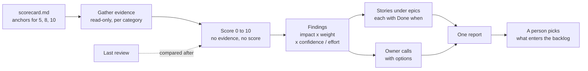

# app-critic

Score the whole product on a scorecard, every score with evidence, and turn what it finds into prioritised stories.

From a review of an invented recipe app, three rows of its scorecard:

| Category | Last | Now | Change | Why, in a user's words | Evidence |
|---|---|---|---|---|---|
| Onboarding | 5.5 | 7 | +1.5 | A new user saves a first recipe inside a minute; sign-up now comes after that first save | E2: a fresh install on a mid-range Android phone, timed from its screen recording. Moved by the release that put sign-up after the first save |
| Retention | 6 | 6 | 0 | The weekly reminder arrives, but a missed week wipes the meal plan | E5: `plan/reset.ts:88` |
| Store listing | 4.5 | 4 | -0.5 | The first screenshot shows settings, where both rivals open on a finished dish | E8: the live listing. E9, E10: the two rivals' listings, linked |

And two of the stories it produced:

> **The listing opens on a finished dish.** Epic: the store page earns the install. Priority 6 = impact 3 on installs x weight 4 x confidence 0.5 / effort S 1. Evidence E8, E9, E10.
> Done when: the first screenshot in every shipped language shows a finished dish with one line on what the user gets.
>
> **A missed week pauses the meal plan instead of wiping it.** Epic: the plan survives real life. Priority 4.5 = impact 3 on day-7 retention x weight 3 x confidence 1 / effort M 2. Evidence E5.
> Done when: a plan left alone for nine days opens on the week it stopped, and a test covers the gap.

## What it does

`app-critic` runs one **critic pass** over the whole product: it reads the project's scorecard, gathers evidence for every category, scores each from 0 to 10, and turns the gaps into stories ranked by one formula. Every score points at evidence a stranger can open: a file and line, a screenshot, a metric with its source, or a link. A category with no evidence is left unscored and listed under Not checked, never guessed.

Scores describe what a user gets from the live version. When the main branch is ahead, the report says what main adds, and a large gap often becomes the top owner call. Anything that needs money, a release, a taste call or a change to a recorded decision goes to the owners as options with a recommendation, not into the stories.

The pass is read-only on the code and the tracker. It writes one report and its screenshots, then hands them to the person who decides. Nothing reaches the backlog until that person picks it.

On its first run in a project, it reads the repo and the product and writes `docs/agents/scorecard.md`: the categories that fit this product (an app or a website), what 5, 8 and 10 mean in each, the evidence that counts, the metric each one moves and its weight, where reviews are posted, and who decides. It asks you only what the repo cannot say.

## When to reach for it

Type `/ghostlabs-skills:app-critic` (installed as the plugin) or `/app-critic` (installed through skills.sh). Only you can start it: it is the expensive pass, and when to spend it is your call.

| Situation | What happens |
|---|---|
| Once per review cycle | A full pass: scorecard, findings, stories under epics, owner calls, one report |
| The first time in a project | Setup writes the scorecard; the first pass is the baseline |
| Before planning a release or a season | The top stories are the candidates, already ranked |
| After a release | The scores show what moved for users, and why |
| One PR or one screen | A code review or a design critique is cheaper and closer |

## Common questions

**Why must every score carry evidence?**
A score without evidence is taste, and taste drifts with the reviewer and with the last number. With evidence, a second reader can check a score in a minute, and a disagreement becomes a question about the evidence rather than a contest of opinions.

**Why write the new score before looking at the last one?**
Anchoring. A reviewer who sees last cycle's 6 writes 6 or 6.5. Scoring from the anchors first lets a score fall when the product slipped, or when last cycle's was generous.

**Why does it not file the stories itself?**
What enters the backlog is a product decision, and a whole-product pass proposes more than a team can build. The report ranks; a person picks. Because the pass writes nothing to the tracker, nothing needs cleaning up when the person disagrees.

**Why score the live version rather than main?**
Users have the live version. When main is far ahead, that gap is the finding.

**What if there is no analytics, or no device to hand?**
The category that needs it stays unscored, Not checked says why and what would make it checkable, and the overall score names how many categories it covers. A guessed score would hide the gap.

**How is the priority worked out?**
Impact from 1 to 5 on the category's metric, times that metric's weight, times confidence (0.5, 0.75 or 1), divided by effort (S 1, M 2, L 4). All four inputs are shown on every story, so anyone can argue with one input instead of with the whole ranking.

**How much does a pass cost?**
It is the expensive review, so it runs once per cycle. Cheap read-only scanners can gather evidence for groups of categories, each in a fresh context; screenshots are taken once per device. The scoring and the stories stay with one agent so the scale stays consistent.

**Does it fit a website?**
Yes. Setup adapts the categories: a website scores a first visit, speed and discovery where an app scores onboarding, engineering and its store listing. A category that does not apply is dropped, not scored 0. It has run on an app and on a website; for a command-line tool or a library, setup has you draft the categories yourselves.

## It's working if

- Every score cites evidence ids, and a second reader lands within half a point of it.
- Scores sometimes go down, and every move of a point or more says what moved it.
- The person picks most of the top stories as they stand, or changes the ranking by arguing one input.
- Owner calls get one-line answers, because the options and the recommendation are already there.
- Not checked shrinks from one review to the next, or says why it cannot.
- The tracker changes only after the person has picked.
- By the next pass, most of the last pass's top stories are done.

## Origin

It came out of shipping RookFlow, a map of grappling for iOS and Android, built by Ghost Robotics Lab with coding agents writing much of the code. The agents worked the backlog one card at a time, and the backlog filled with what was easy to see from the code. Once per review cycle, one whole-app critic pass stepped back, scored what a player actually got on a written scorecard, and turned the gaps into the next cycle's stories.

What it caught became its rules:

- The main branch had become a clearly better app than the one in the stores, and most of the improvement had not shipped. Scoring the live version, with main's additions named beside it, turned a flattering score into an owner call to release sooner.
- Some findings would have reversed a decision the owners had already made. Those now go back to the owners as a call with options, and the score takes the decision as given.
- A category held low by something outside the code, such as a business step only the owners could take, stayed visible as an owner call instead of filling the stories with work nobody could finish.
- Stories that arrived ranked, each with a Done when, got built: by the following pass, most of the previous top stories were done.

The agent's instructions start at [`SKILL.md`](../../skills/product/app-critic/SKILL.md); the scorecard it writes on first use is set out in [`SETUP.md`](../../skills/product/app-critic/SETUP.md).
