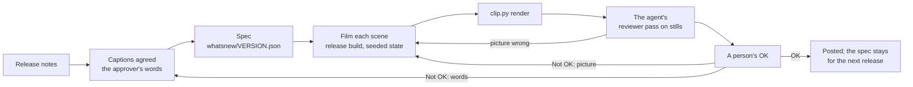

# whats-new-clip

For each release, cut a short What's New clip from the product's real screens: words first, filmed on the real build, reviewed before a person sees it.

## What it does

`whats-new-clip` makes the short vertical clip that tells people what a release changed: an opening card that asks the same question every release and shows the version, one scene per change with its caption, and an end card that says where to get the product. Every scene is filmed on the real release build, from a seeded state that comes out the same on every take, so the clip shows what people will get.

The words come first. The agent turns the release notes into a short caption per change and asks the approver before anything is filmed, keeping their words verbatim wherever they give them. Then it writes the release's spec, films, and renders with one command. Before you see anything, it pulls stills from its own render and checks each one: the scene shows what its caption says, the text fits, nothing private or unfinished is on screen. The clip waits for a person's OK, and the spec stays in the repo, so the next release starts from this one.

The tool is [`clip.py`](../../skills/product/whats-new-clip/scripts/clip.py): `init` writes a spec, `check` names every problem in it (a caption too long to read twice in its scene, a scene too short, more scenes than fit, a missing film, a picture blown up or too small for the frame, low contrast), `render` builds the clip, and `stills` pulls the review stills and a sheet like the one above, tinting the edges a feed covers with its own buttons and captions.

## When to reach for it

Type `/ghostlabs-skills:whats-new-clip` (installed as the plugin) or `/whats-new-clip` (installed through skills.sh). It is user-invoked: the agent never starts a clip on its own, since whether a release gets one is a person's call.

| Situation | What happens |
|---|---|
| A release with changes people will notice | Captions agreed, scenes filmed, one clip per format, a person's OK |
| A release of fixes nobody will notice | The agent asks whether to make a clip at all, and stops unless you say yes |
| The next release | Its spec starts as a copy of the last one: same look, same opening, same end card |
| Another format for a site or a video page | `render --size 1920x1080`; a phone screen is too small in a wide frame, `check` says so, and that format gets its own spec with each scene cropped to its change |

It needs ffmpeg and ffprobe on PATH and [uv](https://docs.astral.sh/uv/) (or Python 3.9+ with Pillow), a way to drive your product with real input, and a project file, `docs/agents/whats-new-clip.md`, which the skill writes on its first run after reading your repo and asking only what it cannot find.

## Common questions

**Why agree the words before filming?**
A reworded caption often needs a different shot, so words agreed late cost a second round of filming. Captions written without the approver tend to describe the screen; theirs say why a person should care.

**Why film the real release build?**
A debug build carries overlays and switches that end up on screen, and a design mock shows what was planned rather than what shipped. The clip promises what the release contains, so it shows exactly that.

**Why open on the same question every release?**
The series becomes recognisable in a feed. The first frame is the clip's cover, so it has to say what the clip is, and the version under the question says which release.

**What about sound?**
Most people watch feeds muted, so the captions carry the message on their own. The default is a silent track, so whoever posts can add licensed music in the platform's editor; a music bed you own can be mixed under at a fixed low level instead.

**How long is a clip?**
At most 30 seconds unless you set otherwise. `check` counts: each caption gets time to be read twice at three words a second, each scene at least 1.5 seconds, and it says when the scenes no longer fit.

**Where do the films go?**
In a clips folder outside the repo, beside the approved clips. They render any scene again, with or without its caption, when a later video needs it.

**Does it post the clip?**
No. It hands the clip to the approver with a sheet of stills, the captions and what was staged, and the person named in the project file posts it.

## It's working if

- The approver changes words before anything is filmed, and rarely after.
- A clip's first frame says what it is and which version, and every release's clip looks like the same series.
- Muted, every scene's still shows what its caption says.
- The agent sometimes films a scene again after its own reviewer pass, before you see the clip.
- The next release's clip starts from the last spec and takes less time than the one before.
- An old release's films still render its scenes.

## Origin

It came out of shipping RookFlow, a map of grappling for iOS and Android, built by Ghost Robotics Lab with coding agents writing much of the code. Every store release got a short vertical What's New clip. The first was cut in one long hand-made session, and about half of it went into finding cut points by scrubbing the films. The job came back with every release, so the hand-made tools became a pipeline: a spec per release, one command to film and one to render, and a learn, build and review pass that turned the first session's dead ends into rules.

Each early miss became a rule in this skill:

- Captions written by the agent read flat to the product owner, who then wrote their own: the words come first, verbatim.
- Cut points found by eye took longest: each step's time is logged as it is filmed.
- A clip that opened straight on a screen gave its cover nothing to say: an opening card from the first frame, the same question every release, the version under it.
- A cut into a screen recording landed on the next screen, because the recording had no frames while nothing moved: films are read at a constant frame rate before they are cut.
- A renamed setting silently changed a seeded scene: seeds and labels are checked against the code before filming.
- Dev labels and a first-run tip showed up on screen: the release build, a settled state, and a reviewer pass on stills.
- A clean-up deleted one release's films, and a later video had to lift shots from the posted clip and paint its captions out: the films are kept.
- A click track and a pitched riser fought the music laid on top: sound is optional and never carries the message.
- One clip was turned down with no reason given: the agent asks once what missed before cutting the same shots again.

The agent's instructions start at [`SKILL.md`](../../skills/product/whats-new-clip/SKILL.md).
